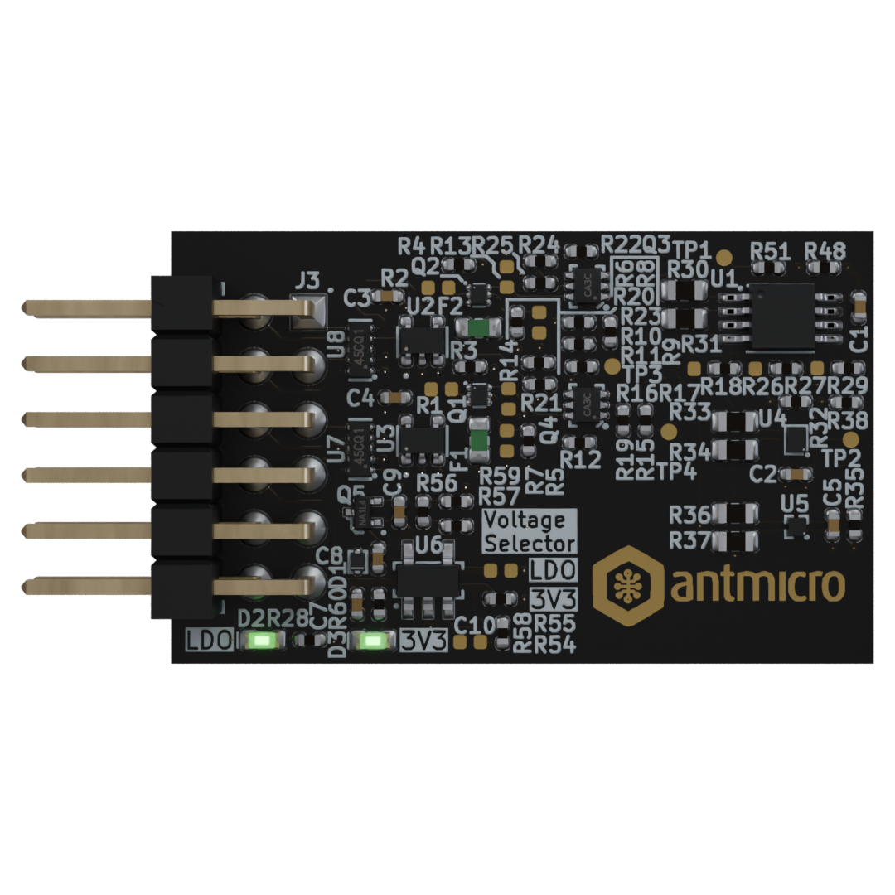

# PMOD I3C Sensor Board

Copyright (c) 2026 [Antmicro](https://www.antmicro.com)

## Overview

This project contains open hardware design files for a PMOD expansion PCB with three I3C sensors:

* [P3T1755DP/Q900Z](https://www.nxp.com/part/P3T1755DP~~Q900)

* [MMC5603NJ](https://www.memsic.com/Public/Uploads/uploadfile/files/20220119/MMC5603NJDatasheetRev.B.pdf)

* [BMA580](https://www.bosch-sensortec.com/media/boschsensortec/downloads/datasheets/bst-bma580-ds000.pdf)

Additionally the board is equipped with two push-pull digital output drivers composed of discrete MOSFETs.
This allows to use the board with FPGA-driven systems to implement I3C output stage driver which can act as open drain or push-pull.
The driver topology is switchable via digital control signals from FPGA-side.
A separate set of control signals allows to activate pull-up or pull-down resistors connected to the output signals.

The design files were prepared in KiCad 9.x.

## Key features

* [P3T1755DP/Q900Z](https://www.nxp.com/part/P3T1755DP~~Q900) - Temperature Sensor with I3C/I2C interface 

* [MMC5603NJ](https://www.memsic.com/Public/Uploads/uploadfile/files/20220119/MMC5603NJDatasheetRev.B.pdf) - 3-axis Magnetic Sensor with I3C/I2C interface 

* [BMA580](https://www.bosch-sensortec.com/media/boschsensortec/downloads/datasheets/bst-bma580-ds000.pdf) - 3-axis accelerometer with I3C/I2C interface 

* Two independent digital output stages configurable as push-pull or open drain

* Switchable pull-up and pull-down resistors

## Licensing

This project is published under the [Apache-2.0](LICENSE) license.
